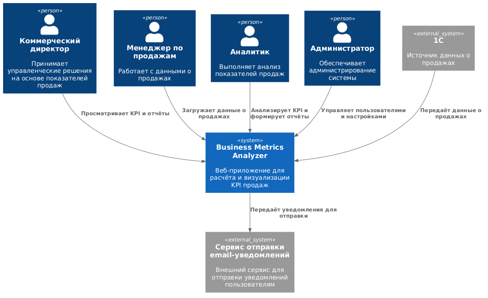
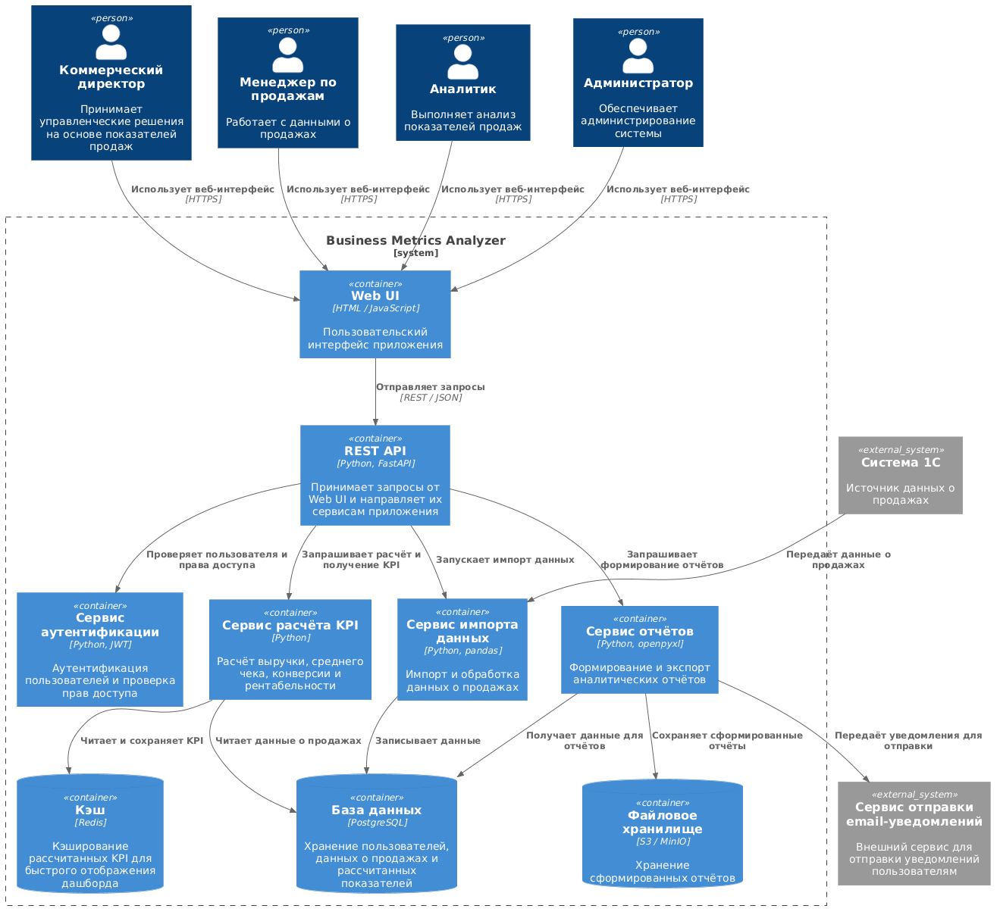
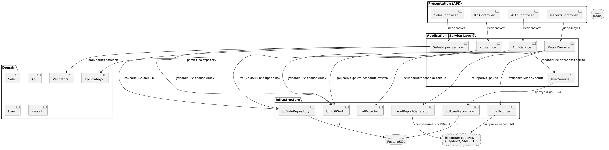
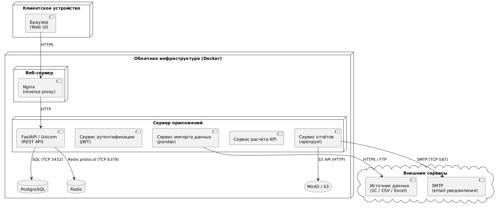

# Архитектура проекта Business Metrics Analyzer

## 1. Обзор

**Business Metrics Analyzer (BMA)** — веб-приложение для расчёта и визуализации KPI торговой компании.
Архитектура проектируется на основе требований и результатов предыдущих практических работ
([business_requirements](../business_requirements.md), [user_stories](../user_stories.md),
[use_case_diagram](../use_case_diagram.png), [product_backlog](../product_backlog.md)).

**Ключевые функциональные области:**

1. аутентификация и управление пользователями (коммерческий директор, менеджер по продажам, аналитик, администратор);
2. загрузка и импорт данных о продажах из CSV, Excel и внешних источников;
3. расчёт KPI: выручка, средний чек, конверсия, рентабельность;
4. визуализация показателей и дашборды;
5. формирование и экспорт отчётов в Excel и PDF;
6. настройка метрик и справочников;
7. логирование и аудит действий.

**Ключевые ограничения:** время отклика дашборда — не более 3 секунд; объём данных — до 1 млн записей о продажах;
развёртывание в облачной среде с использованием Docker; безопасность — аутентификация по JWT и разграничение доступа по ролям.

**Границы системы.** BMA не ведёт учёт продаж: он принимает данные (из 1С, CSV, Excel), считает KPI, показывает их и формирует отчёты.

## 2. Архитектурные драйверы

| ID | Драйвер | Тип | Приоритет | Влияние на архитектуру |
|----|---------|-----|-----------|------------------------|
| AD-01 | Время отклика дашборда — не более 3 секунд | Нефункциональный | Высокий | Требуется обеспечить быстрый доступ к рассчитанным KPI; при необходимости использовать кэширование |
| AD-02 | Обработка до 1 млн записей о продажах | Нефункциональный | Высокий | Необходима эффективная обработка больших объёмов данных и пакетный импорт |
| AD-03 | Аутентификация и разграничение доступа по 4 ролям | Нефункциональный | Высокий | Требуется отдельный механизм аутентификации и авторизации пользователей |
| AD-04 | Импорт данных о продажах из CSV, Excel и API | Функциональный | Средний | Необходим отдельный модуль импорта с поддержкой разных источников данных |
| AD-05 | Расчёт KPI и формирование аналитической отчётности | Функциональный | Высокий | Требуется выделение бизнес-логики расчёта KPI и формирования отчётов |
| AD-06 | Быстрая разработка MVP небольшой командой | Бизнес | Высокий | Архитектура должна быть достаточно простой для быстрой разработки и дальнейшего расширения |

## 3. Архитектурный стиль

Для приложения Business Metrics Analyzer выбран архитектурный стиль **слоистый монолит с элементами Clean Architecture**
(решение зафиксировано в [ADR-001](adr/ADR-001.md)).

Выбор обусловлен следующими факторами:

- проект разрабатывается небольшой командой, поэтому микросервисная архитектура на данном этапе привела бы к излишнему
  усложнению разработки и развёртывания (AD-06);
- необходимо быстро реализовать MVP, поэтому монолит позволяет разрабатывать и развёртывать приложение как единое целое (AD-06);
- приложение включает несколько функциональных областей: импорт данных, расчёт KPI, формирование отчётов, управление
  пользователями и визуализацию показателей. Слоистая архитектура позволяет разделить их ответственность между отдельными слоями
  (AD-04, AD-05);
- элементы Clean Architecture позволяют отделить основную бизнес-логику расчёта KPI от технологий хранения, API и внешних
  сервисов (AD-02, AD-05);
- выбранная архитектура остаётся достаточно простой для текущего проекта, но при дальнейшем развитии позволяет выделить
  отдельные функциональные области в самостоятельные сервисы.

**Слои приложения:**

- **Presentation** — обработка HTTP-запросов и взаимодействие пользователя с функциями системы через API-контроллеры;
- **Application** — реализация пользовательских сценариев и координация работы сервисов (загрузить продажи, рассчитать KPI,
  сформировать отчёт, управлять пользователями);
- **Domain** — бизнес-модели, правила и логика расчёта KPI;
- **Infrastructure** — работа с базой данных, файлами и внешними сервисами (PostgreSQL, репозитории, JWT, генерация Excel,
  email и внешние сервисы).

## 4. Диаграммы

Исходники диаграмм — `.puml` (PlantUML), рядом лежат отрендеренные `.png`.

### 4.1. Диаграмма контекста (C4 L1)

Показывает взаимодействие системы с пользователями и внешними системами. Роли: коммерческий директор — просматривает KPI и
отчёты; менеджер по продажам — загружает данные о продажах; аналитик — анализирует KPI и формирует отчёты; администратор —
управляет пользователями и настройками. Внешние системы: **1С** — источник данных о продажах; **сервис отправки
email-уведомлений**.

Файлы: [context.puml](context.puml), [context.png](context.png)



### 4.2. Диаграмма контейнеров (C4 L2)

Показывает внутреннюю структуру системы: Web UI, REST API (FastAPI), сервисы аутентификации (JWT), импорта данных (pandas),
расчёта KPI и отчётов (openpyxl), а также PostgreSQL, Redis (кэш KPI) и S3 / MinIO (хранилище отчётов).

Файлы: [containers.puml](containers.puml), [containers.png](containers.png)



> «Сервисы» на этой диаграмме — логические модули одного приложения (в монолите они работают в одном процессе, см. 4.4).
> Разделение показано, чтобы зафиксировать границы модулей и упростить будущее выделение сервисов.

### 4.3. Диаграмма компонентов

Показывает декомпозицию приложения по слоям, интерфейсы и направление зависимостей: Presentation → Application → Domain;
Infrastructure реализует интерфейсы, объявленные во внутренних слоях.

Файлы: [components.puml](components.puml), [components.png](components.png)



### 4.4. Диаграмма развёртывания

Показывает физическую схему: браузер клиента → Nginx → контейнер `bma-api` → PostgreSQL, Redis, MinIO; внешние сервисы — SMTP и
источник данных 1С/CSV.

Файлы: [deployment.puml](deployment.puml), [deployment.png](deployment.png)



## 5. Слои и компоненты

| Слой | Компоненты | Ответственность |
|------|-----------|-----------------|
| Presentation | `AuthController`, `SalesController`, `KpiController`, `ReportsController` (FastAPI) | Приём HTTP-запросов, валидация входных данных (DTO), проверка роли, вызов сервисов |
| Application | `AuthService`, `UserService`, `SalesImportService`, `KpiService`, `ReportService` | Бизнес-сценарии, управление транзакциями через Unit of Work |
| Domain | `Sale`, `Kpi`, `User`, `Report`, `KpiStrategy`, `Validators`, интерфейсы репозиториев | Бизнес-правила и модели, не зависящие от фреймворков |
| Infrastructure | `SqlSaleRepository`, `SqlUserRepository`, `UnitOfWork`, `JwtProvider`, `ExcelReportGenerator`, `EmailNotifier`, `RedisKpiCache`, `S3ReportStorage`, `SalesSourceAdapter` | Доступ к БД, кэшу, файловому хранилищу и внешним системам |

**Правило зависимостей:** Presentation → Application → Domain; Infrastructure реализует интерфейсы (порты), объявленные в
Application и Domain (инверсия зависимостей). Domain не импортирует ничего из других слоёв.

Компоненты `RedisKpiCache`, `S3ReportStorage` и `SalesSourceAdapter` добавлены к базовой декомпозиции: они реализуют AD-01 (кэш KPI),
хранение отчётов и интеграцию с источником данных (AD-04). Механизм событий Observer (см. [patterns.md](patterns.md)) работает внутри
слоя Application и на диаграмме не показан, чтобы не перегружать схему.

**Ключевые интерфейсы**

| Компонент | Интерфейс | Методы |
|-----------|-----------|--------|
| `KpiService` | `IKpiService` | `calculate_period(period) -> KpiResult`, `get_dashboard(period) -> DashboardDto` |
| `SalesImportService` | `ISalesImportService` | `import_csv(file) -> ImportResult`, `validate(records) -> ValidationResult` |
| `ReportService` | `IReportService` | `generate(report_type, period) -> ReportFile`, `export_excel(report_id) -> bytes` |
| `AuthService` | `IAuthService` | `login(email, password) -> TokenPair`, `verify(token) -> UserClaims` |
| `UserService` | `IUserService` | `create(dto) -> UserDto`, `assign_role(user_id, role) -> None` |

Структура кода (каждый слой — отдельный пакет, импорты вида `from domain.entities import SaleRecord`):

```
src/
├── presentation/    # FastAPI-роутеры, схемы запросов и ответов (DTO)
├── application/     # сервисы, порты (интерфейсы), события
├── domain/          # entities.py, repositories.py, kpi.py, валидаторы
└── infrastructure/  # db/ (models, repositories, unit_of_work), cache, jwt, excel, smtp, s3
```

## 6. Паттерны проектирования

Восемь паттернов: Repository, Unit of Work, Service Layer, Strategy, Factory, DTO, Adapter, Observer.
Обоснование, альтернативы и примеры кода на Python — в [patterns.md](patterns.md).

## 7. Технологический стек

Python 3.10+, FastAPI + Uvicorn, Pydantic, SQLAlchemy + Alembic, PostgreSQL 16, Redis 7, MinIO (S3), pandas (импорт),
openpyxl (Excel-отчёты), PyJWT, Nginx, Docker / Docker Compose, pytest.

**Параметры развёртывания**

| Узел | Образ / ПО | Ресурсы | Назначение |
|------|-----------|---------|-----------|
| Nginx | `nginx:alpine` | 0.5 CPU, 256 MB | Reverse proxy, TLS |
| App | `bma-api:latest` | 1 CPU, 1 GB | API и бизнес-логика |
| PostgreSQL | `postgres:16` | 2 CPU, 2 GB | Хранение данных |
| Redis | `redis:7-alpine` | 0.5 CPU, 512 MB | Кэш KPI |
| MinIO | `minio/minio` | 0.5 CPU, 512 MB | Хранение отчётов |

## 8. Ограничения и компромиссы

- **Масштабирование ограничено:** монолит масштабируется целиком. Смягчение: приложение stateless (состояние — в PostgreSQL и
  Redis), поэтому можно запускать несколько реплик `bma-api` за Nginx.
- **Долгий импорт** (до 1 млн строк, AD-02) выполняется в фоне и пакетами по 10 000 записей; пользователь видит статус задачи.
- **Кэш KPI может отставать** до инвалидации (TTL + сброс по событию «данные импортированы») — приемлемо для аналитики (AD-01).
- **Единая БД** для данных и журнала аудита: проще для MVP, но при росте аудит стоит вынести отдельно.
- **Дисциплина слоёв:** монолит не защищает от нарушений границ автоматически; правила зависимостей нужно проверять на ревью.

## 9. План развития

1. Вынести фоновую обработку импорта в очередь задач (Celery или RQ поверх Redis).
2. Выделить **сервис отчётов** в отдельный контейнер — самая тяжёлая по CPU и наиболее независимая часть.
3. Выделить сервис импорта; добавить API-gateway; при необходимости разделить БД по сервисам.
4. Добавить метрики и трассировку (Prometheus / Grafana, OpenTelemetry).

## 10. Ссылки на ADR

- [ADR-001. Выбор архитектурного стиля](adr/ADR-001.md)
- [ADR-002. Выбор СУБД (PostgreSQL vs SQLite)](adr/ADR-002.md)
- [ADR-003. Выбор способа аутентификации (JWT vs сессии)](adr/ADR-003.md)
